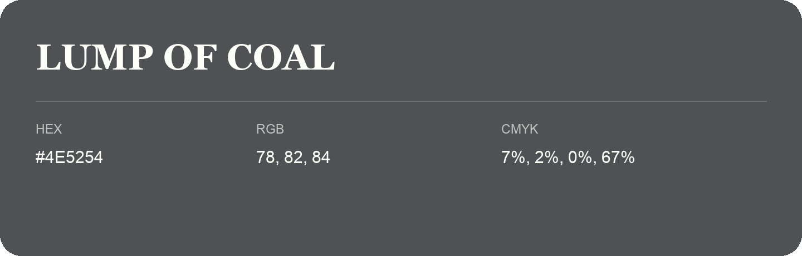

## Lump Of Coal

- HEX: #4E5254
- RGB: 78, 82, 84
- CMYK: 7%, 2%, 0%, 67%
- Character: restrained, grounded, sophisticated
- Suggested uses: premium brands, editorial typography, dark backgrounds

- Source images: IMG_9107.JPG
