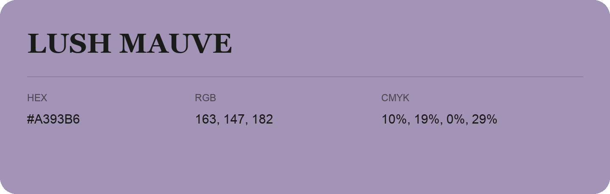

## Lush Mauve

- HEX: #A393B6
- RGB: 163, 147, 182
- CMYK: 10%, 19%, 0%, 29%
- Character: expressive, imaginative, refined
- Suggested uses: beauty brands, creative businesses, distinctive accents

- Source images: IMG_9033.JPG

- Data provenance: RGB calculated from HEX, matching the page; source image RGB was unreadable.
