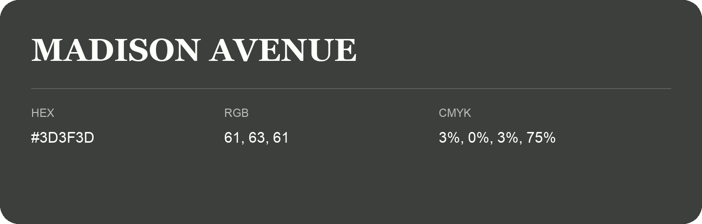

## Madison Avenue

- HEX: #3D3F3D
- RGB: 61, 63, 61
- CMYK: 3%, 0%, 3%, 75%
- Character: restrained, grounded, sophisticated
- Suggested uses: premium brands, editorial typography, dark backgrounds

- Source images: IMG_9046.JPG
