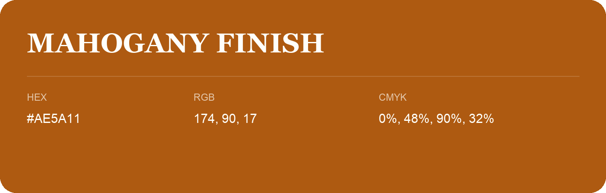

## Mahogany Finish

- HEX: #AE5A11
- RGB: 174, 90, 17
- CMYK: 0%, 48%, 90%, 32%
- Character: earthy, rich, warm
- Suggested uses: artisan businesses, hospitality brands, warm accents

- Source images: IMG_9074.JPG

- Data provenance: HEX recovered from page data; cross-checked against the readable source RGB.
