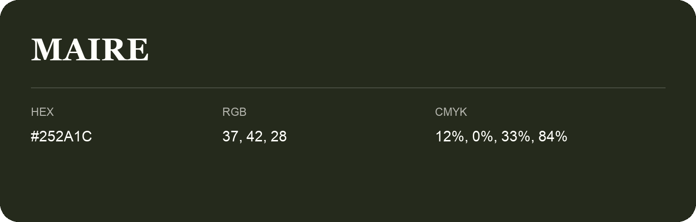

## Maire

- HEX: #252A1C
- RGB: 37, 42, 28
- CMYK: 12%, 0%, 33%, 84%
- Character: deep, grounded, understated
- Suggested uses: premium packaging, editorial typography, dark backgrounds

- Source images: IMG_9014.JPG

- Name note: Other distinct shades share this name: [maire-272a1d](maire-272a1d.md), [maire-292c21](maire-292c21.md).
