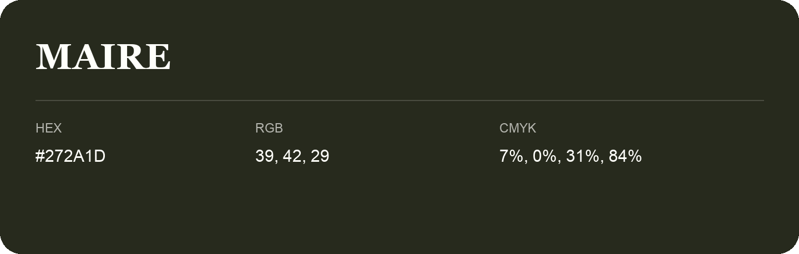

## Maire

- HEX: #272A1D
- RGB: 39, 42, 29
- CMYK: 7%, 0%, 31%, 84%
- Character: deep, grounded, understated
- Suggested uses: premium packaging, editorial typography, dark backgrounds

- Source images: iCloud Photos 2/IMG_9176.JPG

- Name note: Other distinct shades share this name: [maire-252a1c](maire-252a1c.md), [maire-292c21](maire-292c21.md).
