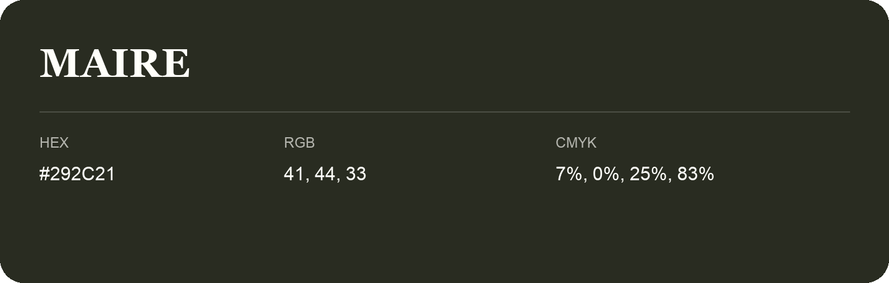

## Maire

- HEX: #292C21
- RGB: 41, 44, 33
- CMYK: 7%, 0%, 25%, 83%
- Character: deep, grounded, understated
- Suggested uses: premium packaging, editorial typography, dark backgrounds

- Source images: IMG_8980.JPG

- Name note: Other distinct shades share this name: [maire-252a1c](maire-252a1c.md), [maire-272a1d](maire-272a1d.md).
