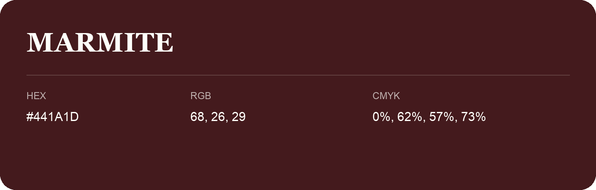

## Marmite

- HEX: #441A1D
- RGB: 68, 26, 29
- CMYK: 0%, 62%, 57%, 73%
- Character: warm, expressive, energetic
- Suggested uses: food brands, expressive identities, promotional accents

- Source images: IMG_9037.JPG
