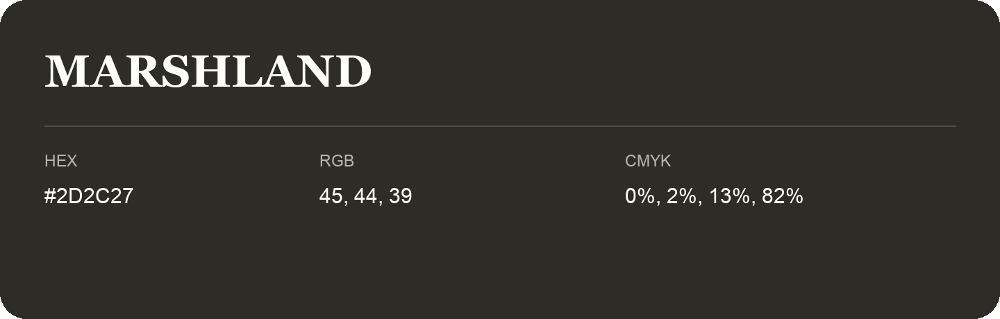

## Marshland

- HEX: #2D2C27
- RGB: 45, 44, 39
- CMYK: 0%, 2%, 13%, 82%
- Character: deep, grounded, understated
- Suggested uses: premium packaging, editorial typography, dark backgrounds

- Source images: iCloud Photos 2/IMG_9127.JPG
