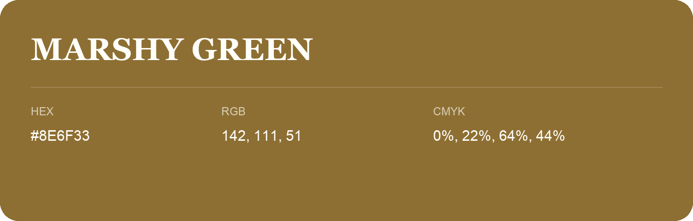

## Marshy Green

- HEX: #8E6F33
- RGB: 142, 111, 51
- CMYK: 0%, 22%, 64%, 44%
- Character: earthy, rich, warm
- Suggested uses: artisan businesses, hospitality brands, warm accents

- Source images: IMG_9035.JPG
