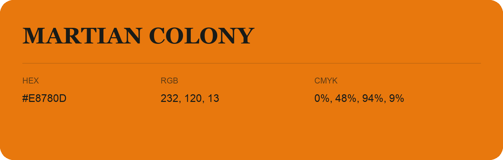

## Martian Colony

- HEX: #E8780D
- RGB: 232, 120, 13
- CMYK: 0%, 48%, 94%, 9%
- Character: earthy, rich, warm
- Suggested uses: artisan businesses, hospitality brands, warm accents

- Source images: IMG_9040.JPG
