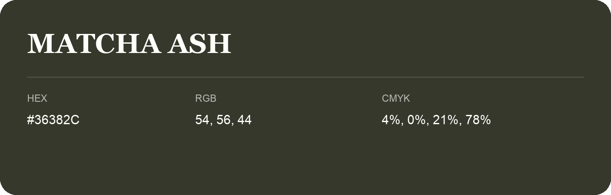

## Matcha Ash

- HEX: #36382C
- RGB: 54, 56, 44
- CMYK: 4%, 0%, 21%, 78%
- Character: sunny, lively, optimistic
- Suggested uses: friendly consumer brands, food packaging, cheerful accents

- Source images: IMG_9109.JPG
