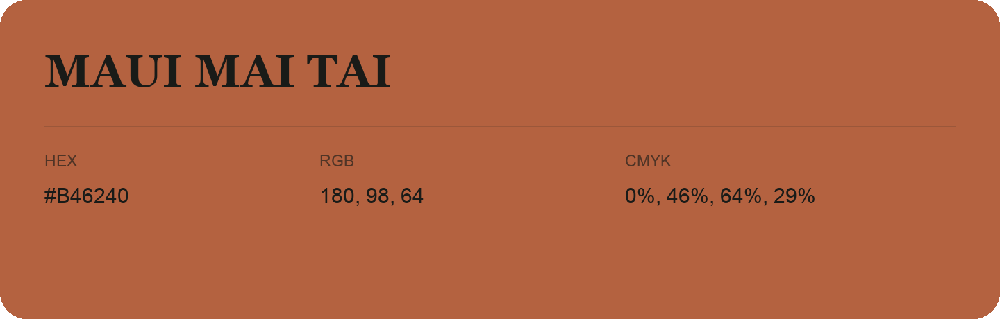

## Maui Mai Tai

- HEX: #B46240
- RGB: 180, 98, 64
- CMYK: 0%, 46%, 64%, 29%
- Character: earthy, rich, warm
- Suggested uses: artisan businesses, hospitality brands, warm accents

- Source images: IMG_9054.JPG
