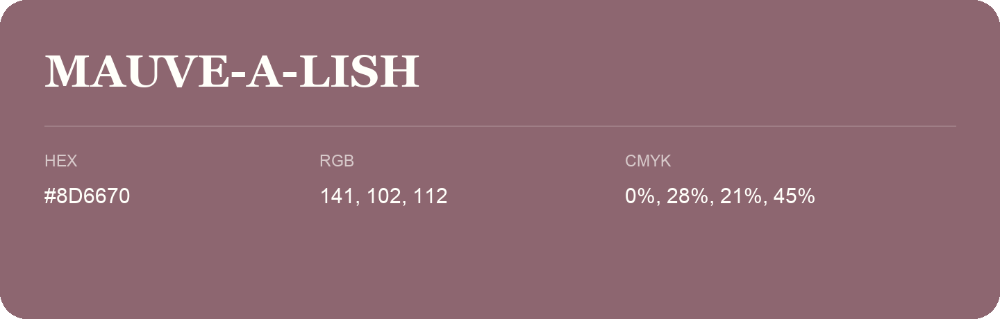

## Mauve-A-Lish

- HEX: #8D6670
- RGB: 141, 102, 112
- CMYK: 0%, 28%, 21%, 45%
- Character: expressive, imaginative, refined
- Suggested uses: beauty brands, creative businesses, distinctive accents

- Source images: iCloud Photos 2/IMG_9134.JPG
