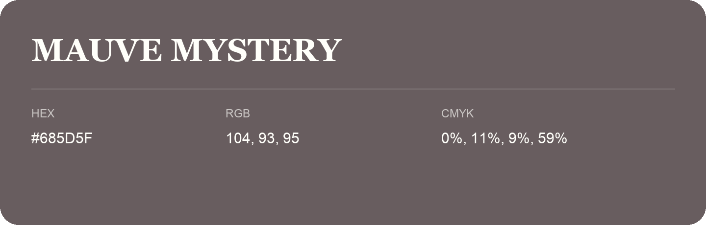

## Mauve Mystery

- HEX: #685D5F
- RGB: 104, 93, 95
- CMYK: 0%, 11%, 9%, 59%
- Character: restrained, grounded, sophisticated
- Suggested uses: premium brands, editorial typography, dark backgrounds

- Source images: IMG_9094.JPG
