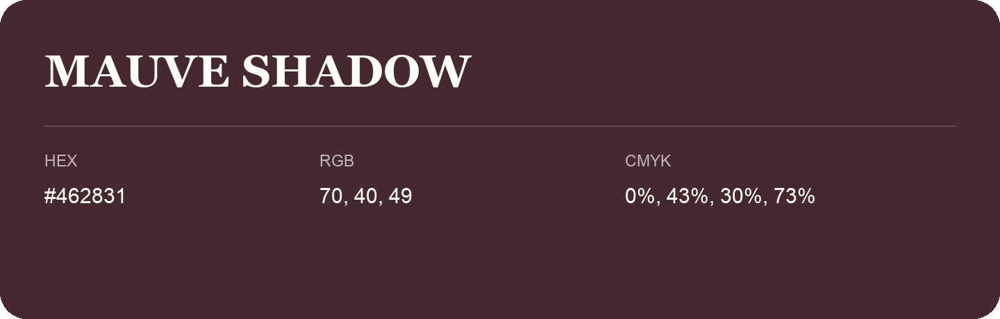

## Mauve Shadow

- HEX: #462831
- RGB: 70, 40, 49
- CMYK: 0%, 43%, 30%, 73%
- Character: expressive, imaginative, refined
- Suggested uses: beauty brands, creative businesses, distinctive accents

- Source images: IMG_8992.JPG
