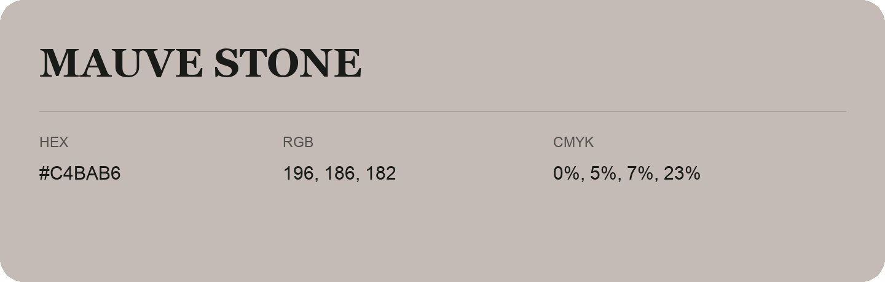

## Mauve Stone

- HEX: #C4BAB6
- RGB: 196, 186, 182
- CMYK: 0%, 5%, 7%, 23%
- Character: quiet, balanced, understated
- Suggested uses: professional services, minimal identities, supporting backgrounds

- Source images: IMG_9013.JPG
