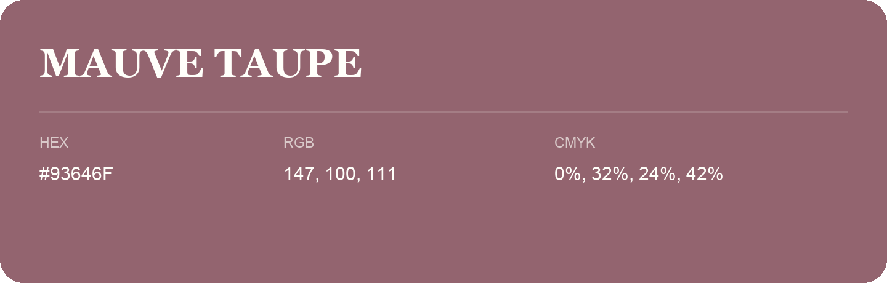

## Mauve Taupe

- HEX: #93646F
- RGB: 147, 100, 111
- CMYK: 0%, 32%, 24%, 42%
- Character: warm, expressive, energetic
- Suggested uses: food brands, expressive identities, promotional accents

- Source images: iCloud Photos 2/IMG_9140.JPG
