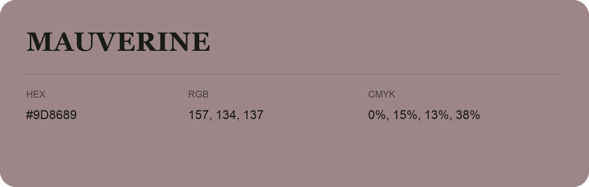

## Mauverine

- HEX: #9D8689
- RGB: 157, 134, 137
- CMYK: 0%, 15%, 13%, 38%
- Character: warm, expressive, energetic
- Suggested uses: food brands, expressive identities, promotional accents

- Source images: IMG_9093.JPG
