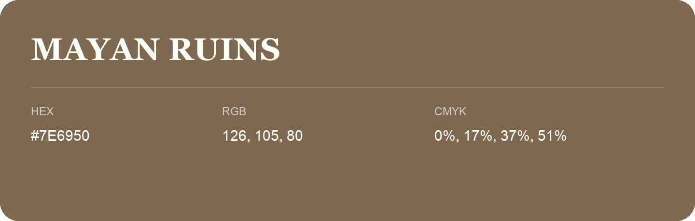

## Mayan Ruins

- HEX: #7E6950
- RGB: 126, 105, 80
- CMYK: 0%, 17%, 37%, 51%
- Character: earthy, rich, warm
- Suggested uses: premium packaging, rustic brands, dark backgrounds

- Source images: IMG_8999.JPG
