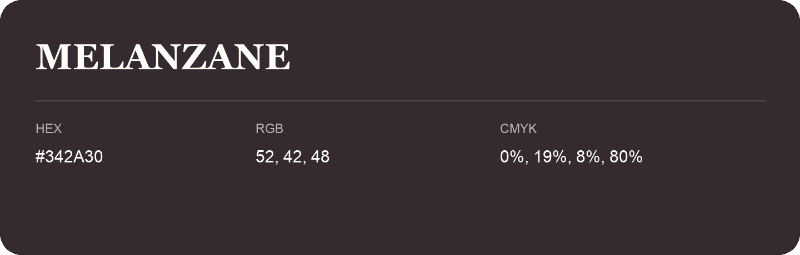

## Melanzane

- HEX: #342A30
- RGB: 52, 42, 48
- CMYK: 0%, 19%, 8%, 80%
- Character: expressive, imaginative, refined
- Suggested uses: beauty brands, creative businesses, distinctive accents

- Source images: IMG_9013.JPG
