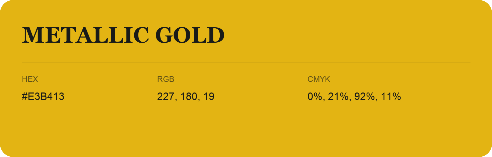

## Metallic Gold

- HEX: #E3B413
- RGB: 227, 180, 19
- CMYK: 0%, 21%, 92%, 11%
- Character: sunny, lively, optimistic
- Suggested uses: friendly consumer brands, food packaging, cheerful accents

- Source images: IMG_8982.JPG

- Data provenance: HEX recovered from page data; cross-checked against the readable source RGB.
