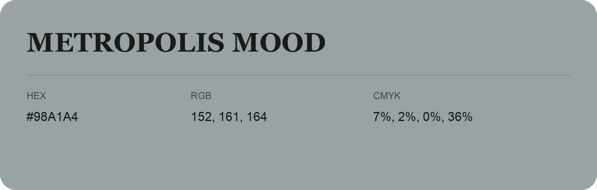

## Metropolis Mood

- HEX: #98A1A4
- RGB: 152, 161, 164
- CMYK: 7%, 2%, 0%, 36%
- Character: quiet, balanced, understated
- Suggested uses: professional services, minimal identities, supporting backgrounds

- Source images: IMG_9010.JPG

- Data provenance: RGB calculated from HEX, matching the page; source image RGB was unreadable.
