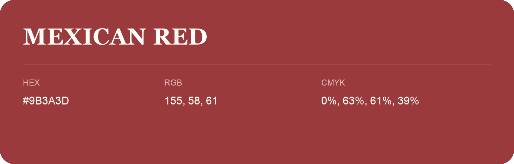

## Mexican Red

- HEX: #9B3A3D
- RGB: 155, 58, 61
- CMYK: 0%, 63%, 61%, 39%
- Character: warm, expressive, energetic
- Suggested uses: food brands, expressive identities, promotional accents

- Source images: IMG_9046.JPG
