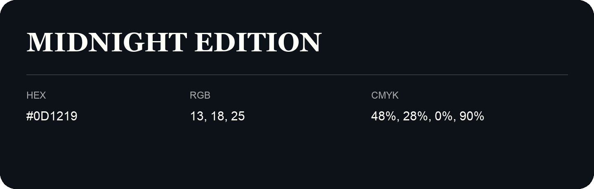

## Midnight Edition

- HEX: #0D1219
- RGB: 13, 18, 25
- CMYK: 48%, 28%, 0%, 90%
- Character: cool, composed, dependable
- Suggested uses: professional services, technology brands, calm backgrounds

- Source images: IMG_9030.JPG

- Data provenance: HEX recovered from page data; cross-checked against the readable source RGB.
