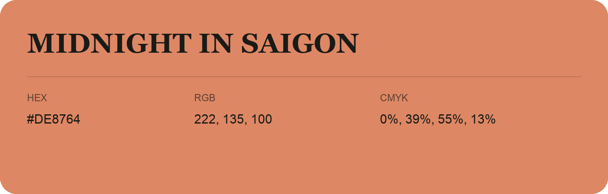

## Midnight In Saigon

- HEX: #DE8764
- RGB: 222, 135, 100
- CMYK: 0%, 39%, 55%, 13%
- Character: earthy, rich, warm
- Suggested uses: artisan businesses, hospitality brands, warm accents

- Source images: iCloud Photos 2/IMG_9153.JPG
- Data provenance: RGB calculated from HEX; source text recognition was uncertain.
