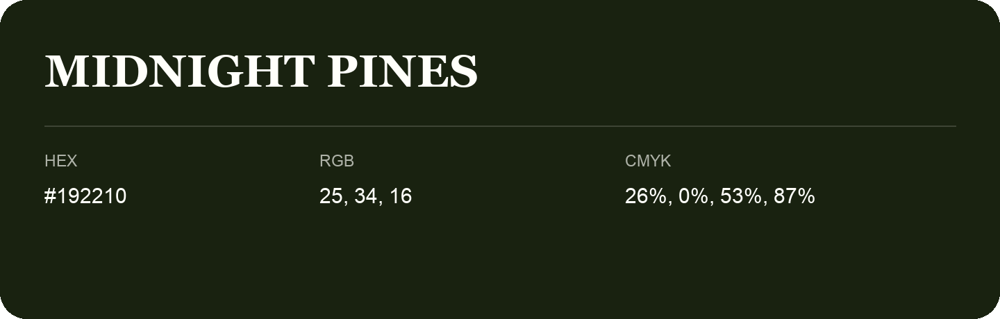

## Midnight Pines

- HEX: #192210
- RGB: 25, 34, 16
- CMYK: 26%, 0%, 53%, 87%
- Character: deep, grounded, understated
- Suggested uses: premium packaging, editorial typography, dark backgrounds

- Source images: IMG_9006.JPG

- Name note: Other distinct shades share this name: [midnight-pines-1b1f0e](midnight-pines-1b1f0e.md), [midnight-pines-1c220b](midnight-pines-1c220b.md).
