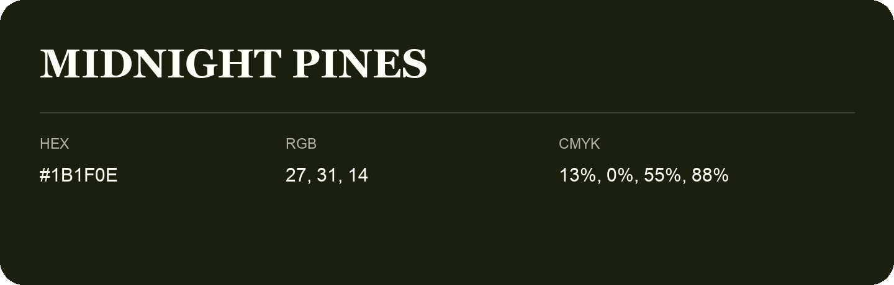

## Midnight Pines

- HEX: #1B1F0E
- RGB: 27, 31, 14
- CMYK: 13%, 0%, 55%, 88%
- Character: deep, grounded, understated
- Suggested uses: premium packaging, editorial typography, dark backgrounds

- Source images: iCloud Photos 2/IMG_9125.JPG

- Name note: Other distinct shades share this name: [midnight-pines-192210](midnight-pines-192210.md), [midnight-pines-1c220b](midnight-pines-1c220b.md).
