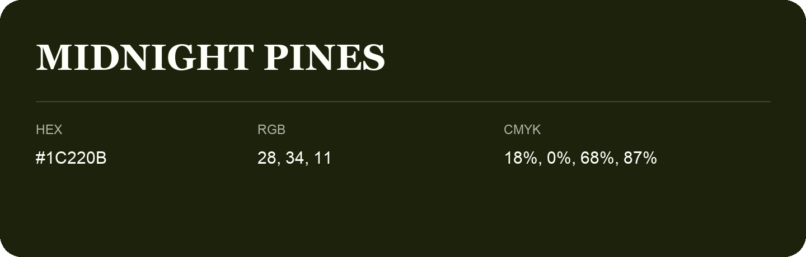

## Midnight Pines

- HEX: #1C220B
- RGB: 28, 34, 11
- CMYK: 18%, 0%, 68%, 87%
- Character: deep, grounded, understated
- Suggested uses: premium packaging, editorial typography, dark backgrounds

- Source images: IMG_9053.JPG

## Consolidated source variants

This is the canonical library entry. Same-name variants below are within ΔE00 ≤ 1 of this shade and were consolidated editorially. Their source values are preserved; they were not source errors.

### Source variant #1D2208

- HEX: #1D2208
- RGB: 29, 34, 8
- CMYK: 15%, 0%, 76%, 87%
- Difference from canonical: ΔE00 0.9012.
- Source images: IMG_9070.JPG

- Name note: Other distinct shades share this name: [midnight-pines-192210](midnight-pines-192210.md), [midnight-pines-1b1f0e](midnight-pines-1b1f0e.md).
