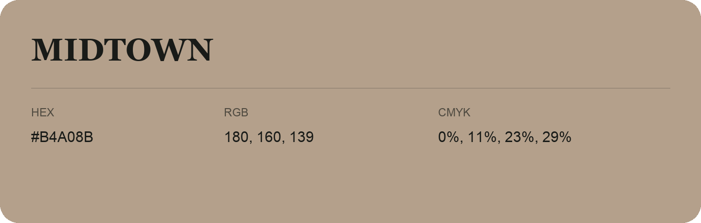

## Midtown

- HEX: #B4A08B
- RGB: 180, 160, 139
- CMYK: 0%, 11%, 23%, 29%
- Character: earthy, rich, warm
- Suggested uses: artisan businesses, hospitality brands, warm accents

- Source images: IMG_8999.JPG

- Data provenance: RGB calculated from HEX, matching the page; source image RGB was unreadable.
