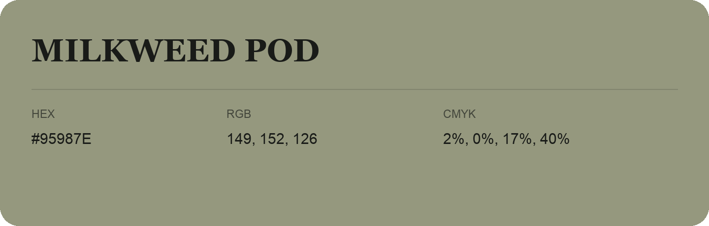

## Milkweed Pod

- HEX: #95987E
- RGB: 149, 152, 126
- CMYK: 2%, 0%, 17%, 40%
- Character: sunny, lively, optimistic
- Suggested uses: friendly consumer brands, food packaging, cheerful accents

- Source images: IMG_9077.JPG

- Data provenance: RGB calculated from HEX, matching the page; source image RGB was unreadable.
