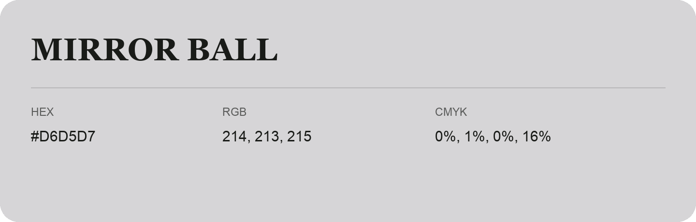

## Mirror Ball

- HEX: #D6D5D7
- RGB: 214, 213, 215
- CMYK: 0%, 1%, 0%, 16%
- Character: quiet, balanced, understated
- Suggested uses: professional services, minimal identities, supporting backgrounds

- Source images: IMG_9060.JPG
