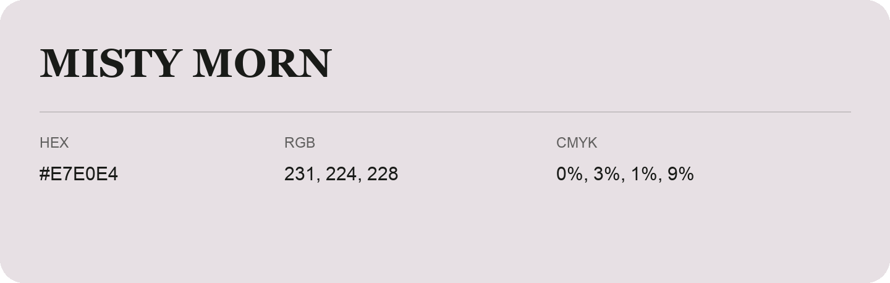

## Misty Morn

- HEX: #E7E0E4
- RGB: 231, 224, 228
- CMYK: 0%, 3%, 1%, 9%
- Character: quiet, balanced, understated
- Suggested uses: professional services, minimal identities, supporting backgrounds

- Source images: IMG_9001.JPG

- Data provenance: HEX recovered from page data; cross-checked against the readable source RGB.
