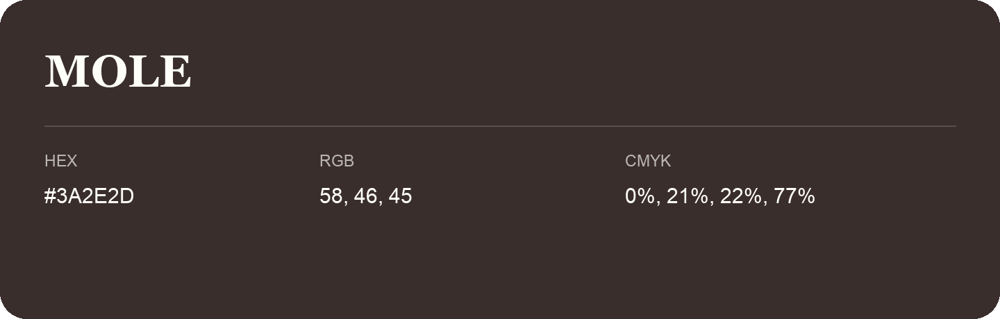

## Mole

- HEX: #3A2E2D
- RGB: 58, 46, 45
- CMYK: 0%, 21%, 22%, 77%
- Character: deep, grounded, understated
- Suggested uses: premium packaging, editorial typography, dark backgrounds

- Source images: iCloud Photos 2/IMG_9158.JPG
