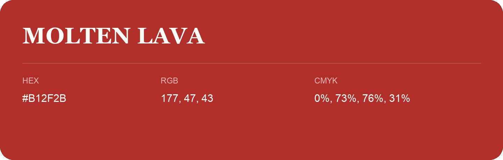

## Molten Lava

- HEX: #B12F2B
- RGB: 177, 47, 43
- CMYK: 0%, 73%, 76%, 31%
- Character: warm, expressive, energetic
- Suggested uses: food brands, expressive identities, promotional accents

- Source images: iCloud Photos 2/IMG_9123.JPG
