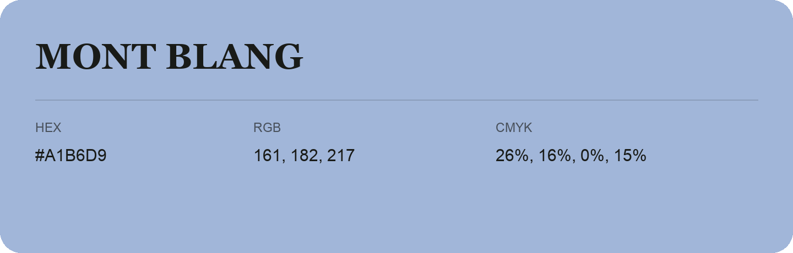

## Mont Blang

- HEX: #A1B6D9
- RGB: 161, 182, 217
- CMYK: 26%, 16%, 0%, 15%
- Character: soft, gentle, approachable
- Suggested uses: friendly consumer brands, gentle backgrounds, welcoming accents

- Source images: IMG_9091.JPG
