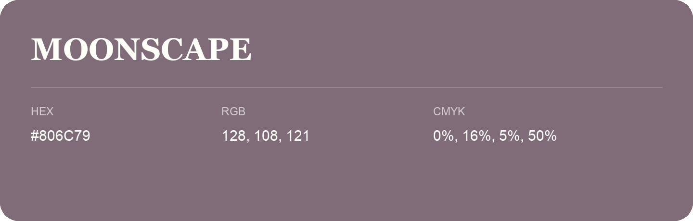

## Moonscape

- HEX: #806C79
- RGB: 128, 108, 121
- CMYK: 0%, 16%, 5%, 50%
- Character: expressive, imaginative, refined
- Suggested uses: beauty brands, creative businesses, distinctive accents

- Source images: IMG_9108.JPG
