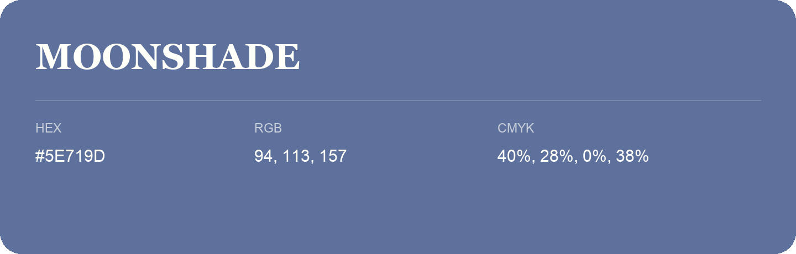

## Moonshade

- HEX: #5E719D
- RGB: 94, 113, 157
- CMYK: 40%, 28%, 0%, 38%
- Character: cool, composed, dependable
- Suggested uses: professional services, technology brands, calm backgrounds

- Source images: iCloud Photos 2/IMG_9187.JPG
- Data provenance: RGB calculated from HEX; source text recognition was uncertain.
