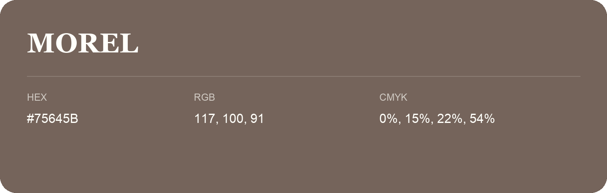

## Morel

- HEX: #75645B
- RGB: 117, 100, 91
- CMYK: 0%, 15%, 22%, 54%
- Character: earthy, rich, warm
- Suggested uses: premium packaging, rustic brands, dark backgrounds

- Source images: iCloud Photos 2/IMG_9138.JPG

- Name note: Other distinct shades share this name: [morel](morel.md).
