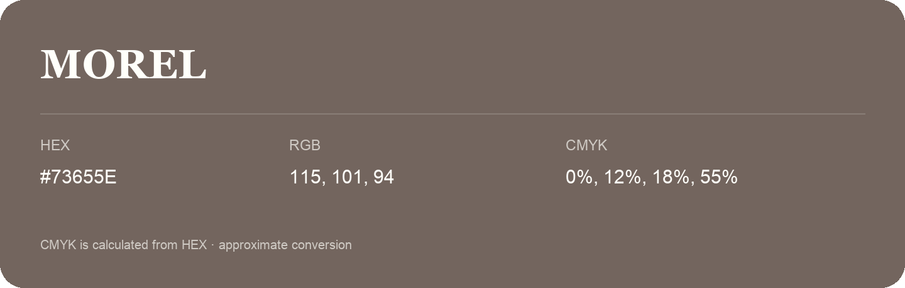

## Morel

- HEX: #73655E
- RGB: 115, 101, 94
- CMYK: 0%, 12%, 18%, 55%
- Character: earthy, rich, warm
- Suggested uses: premium packaging, rustic brands, dark backgrounds

- Source images: IMG_9018.JPG

- Data provenance: CMYK calculated from HEX using the page’s conversion; source image CMYK was unreadable. This is an approximate conversion without a print color profile.

- Name note: Other distinct shades share this name: [morel-75645b](morel-75645b.md).
