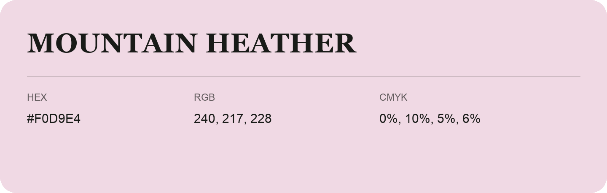

## Mountain Heather

- HEX: #F0D9E4
- RGB: 240, 217, 228
- CMYK: 0%, 10%, 5%, 6%
- Character: quiet, balanced, understated
- Suggested uses: professional services, minimal identities, supporting backgrounds

- Source images: IMG_9108.JPG

- Data provenance: HEX recovered from page data; cross-checked against the readable source RGB.
