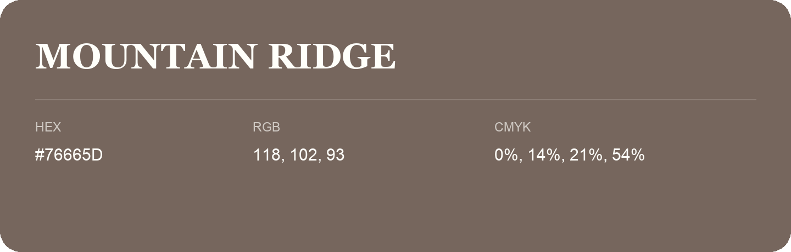

## Mountain Ridge

- HEX: #76665D
- RGB: 118, 102, 93
- CMYK: 0%, 14%, 21%, 54%
- Character: earthy, rich, warm
- Suggested uses: premium packaging, rustic brands, dark backgrounds

- Source images: IMG_9105.JPG
