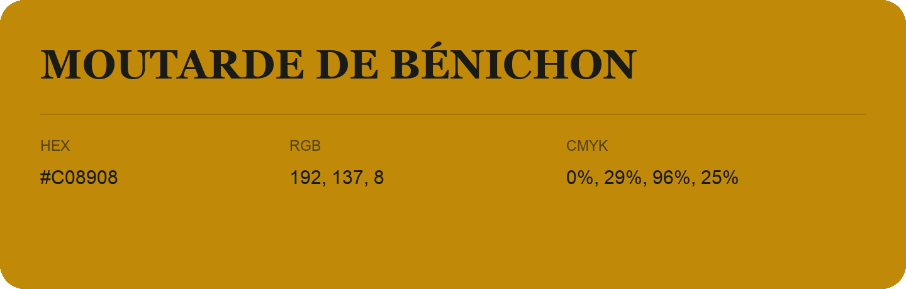

## Moutarde De Bénichon

- HEX: #C08908
- RGB: 192, 137, 8
- CMYK: 0%, 29%, 96%, 25%
- Character: earthy, rich, warm
- Suggested uses: artisan businesses, hospitality brands, warm accents

- Source images: IMG_9044.JPG
