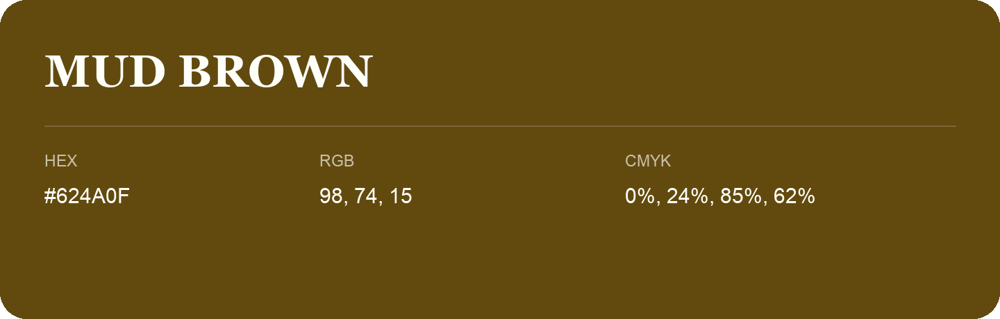

## Mud Brown

- HEX: #624A0F
- RGB: 98, 74, 15
- CMYK: 0%, 24%, 85%, 62%
- Character: earthy, rich, warm
- Suggested uses: premium packaging, rustic brands, dark backgrounds

- Source images: IMG_9073.JPG

- Data provenance: HEX recovered from page data; cross-checked against the readable source RGB.
