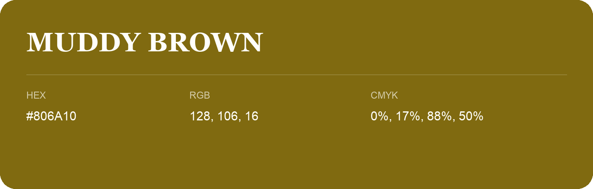

## Muddy Brown

- HEX: #806A10
- RGB: 128, 106, 16
- CMYK: 0%, 17%, 88%, 50%
- Character: sunny, lively, optimistic
- Suggested uses: friendly consumer brands, food packaging, cheerful accents

- Source images: iCloud Photos 2/IMG_9170.JPG

- Name note: Other distinct shades share this name: [muddy-brown](muddy-brown.md).
