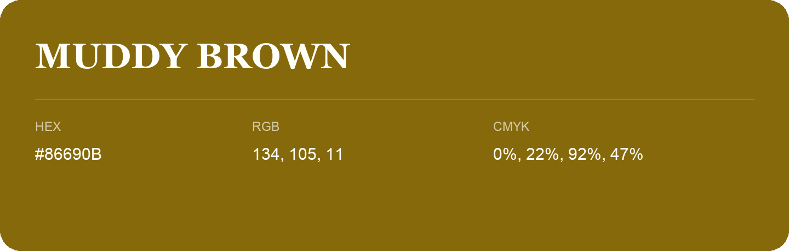

## Muddy Brown

- HEX: #86690B
- RGB: 134, 105, 11
- CMYK: 0%, 22%, 92%, 47%
- Character: sunny, lively, optimistic
- Suggested uses: friendly consumer brands, food packaging, cheerful accents

- Source images: iCloud Photos 2/IMG_9141.JPG

- Name note: Other distinct shades share this name: [muddy-brown-806a10](muddy-brown-806a10.md).
