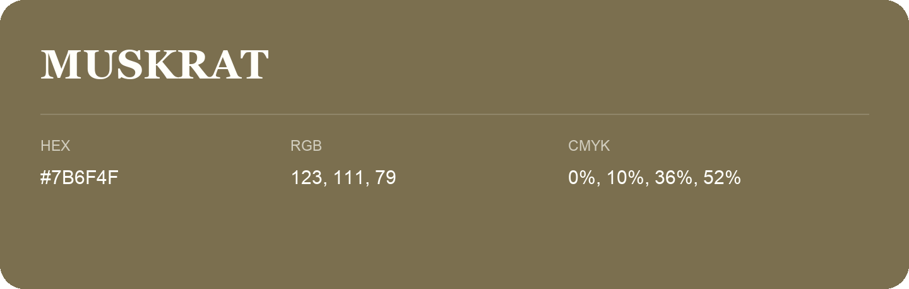

## Muskrat

- HEX: #7B6F4F
- RGB: 123, 111, 79
- CMYK: 0%, 10%, 36%, 52%
- Character: earthy, rich, warm
- Suggested uses: premium packaging, rustic brands, dark backgrounds

- Source images: IMG_9079.JPG
