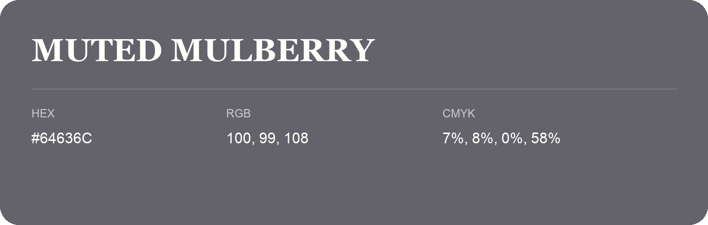

## Muted Mulberry

- HEX: #64636C
- RGB: 100, 99, 108
- CMYK: 7%, 8%, 0%, 58%
- Character: restrained, grounded, sophisticated
- Suggested uses: premium brands, editorial typography, dark backgrounds

- Source images: IMG_9085.JPG

- Data provenance: RGB calculated from HEX, matching the page; source image RGB was unreadable.
