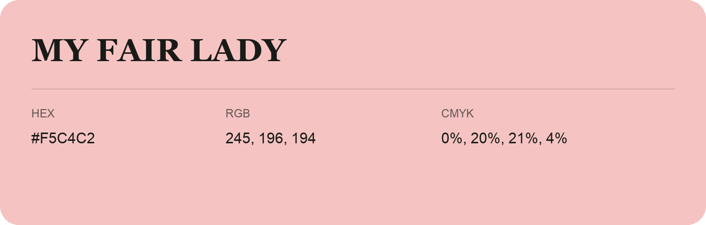

## My Fair Lady

- HEX: #F5C4C2
- RGB: 245, 196, 194
- CMYK: 0%, 20%, 21%, 4%
- Character: soft, warm, playful
- Suggested uses: friendly consumer brands, gentle backgrounds, welcoming accents

- Source images: IMG_9082.JPG

- Data provenance: RGB calculated from HEX, matching the page; source image RGB was unreadable.
