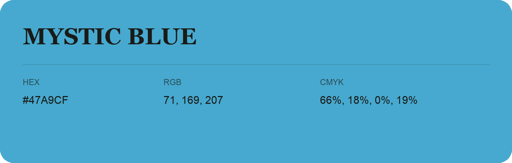

## Mystic Blue

- HEX: #47A9CF
- RGB: 71, 169, 207
- CMYK: 66%, 18%, 0%, 19%
- Character: calm, fresh, composed
- Suggested uses: wellness brands, coastal hospitality, modern service brands

- Source images: IMG_9002.JPG

- Data provenance: RGB calculated from HEX, matching the page; source image RGB was unreadable.
